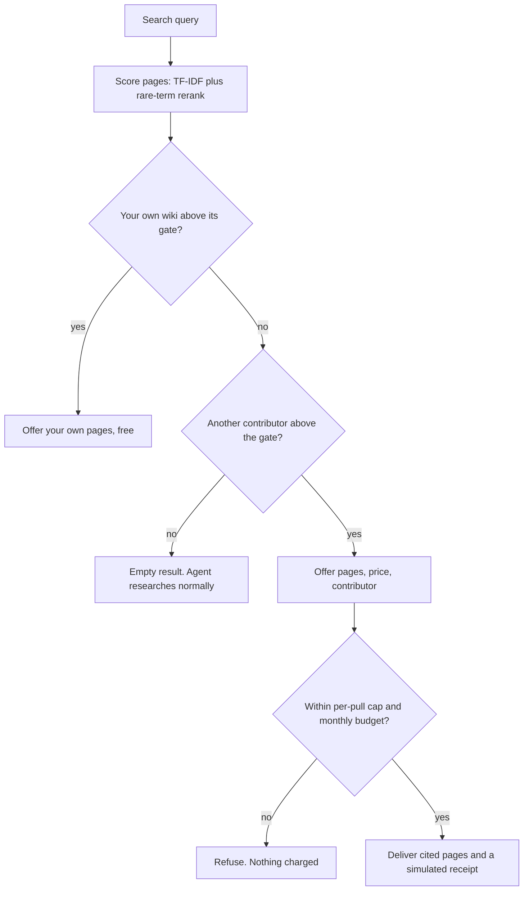

# Cloud Brain

[](https://github.com/ayushcchoudhary-hub/cloud-brain/actions/workflows/test.yml)

An MCP server that lets an AI session reuse research someone else already
compiled. People publish their markdown research wikis. When your agent hits a
topic that someone has covered in depth, it offers to pull that research into
the session for a few dollars. When nothing matches, it stays quiet.

Built over two days in April 2026, a few days after Karpathy's post on
LLM-compiled personal wikis. Shelved soon after. Payments were always
simulated. Prices show in USDC for readability, and nothing touches a chain.


The chat window is a mockup. Every tool call and tool response in it is real
output from this server, taken from [docs/demo-transcript.json](docs/demo-transcript.json).
You can reproduce it with `npm run demo`.

## The problem

Deep research with an LLM is expensive and then thrown away. Converging on one
topic took me days of sessions, millions of tokens and, by my estimate at the
time, $15 to $50 of API cost. The next person who researches the same topic
starts from zero and pays the full cost again.

The output of that work, a compiled wiki page, still has salvage value. The bet:

> An agent will pay about $3 mid-session for research someone already
> compiled, instead of spending $30 and two days re-deriving it.

The pulled research is an input, not a finished answer. Your own session adapts
it to your context.

## Why April 2026

Three things showed up at the same time:

- **Structured supply.** Karpathy-style wikis gave people a standard way to keep
  compiled LLM research as linked markdown pages.
- **Distribution.** MCP put one tool interface inside Claude, ChatGPT, Cursor
  and other clients. A network could live inside the session instead of on a
  website nobody visits.
- **Payments machines can make.** Stablecoins made a $3 payment between two
  agents cheap enough to be worth doing.

## How it works

```mermaid
sequenceDiagram
  participant U as You
  participant A as Your AI client
  participant CB as Cloud Brain MCP server
  participant N as Published wikis
  U->>A: research question
  A->>CB: cloud_brain_search(query)
  CB->>N: TF-IDF match, rerank, confidence gate
  alt confident match from someone else
    CB-->>A: who covered it, what it covers, price
    A->>U: "Wren compiled this. Pull it for $3.27?"
    U->>A: yes
    A->>CB: cloud_brain_pull(query, contributor)
    CB-->>A: cited pages + simulated USDC receipt
  else your own wiki covers it
    CB-->>A: your pages, free
  else nothing confident
    CB-->>A: empty result, nothing charged
  end
```



The confidence gate is what keeps it low-noise. A weak match is worse than no
match, so the server would rather return nothing:



Pages are checked for prompt injection when published (flagged pages are
quarantined) and again when pulled. A content hash confirms a page did not
change after publishing. The publish preview and every pulled answer are
scanned for PII.

### Tools

| Tool | Purpose |
|---|---|
| `cloud_brain_search` | Check published wikis (yours first) during deep research. Returns nothing when no match is confident |
| `cloud_brain_pull` | Pull cited pages from one contributor, within price and budget limits. Returns a simulated receipt |
| `cloud_brain_feedback` | Rate whether a pull helped. Feeds contributor reputation |

The old marketplace view (`cloud_brain_quote`, `cloud_brain_settle`,
`cloud_brain_history`, `cloud_brain_marketplace_summary`) is still there, behind
`CLOUD_BRAIN_MARKETPLACE=true`.

## Run it yourself

Needs Node.js 22. No API keys, no database. It runs in memory on three
fictional sample wikis: Wren (LLM evals), Otter (MCP server design, treated as
"your" wiki) and Finch (home espresso, there so that some questions match
nothing).

```sh
npm install
npm run demo   # the scripted session, driven through a real MCP client
npm test       # 25 tests: parser, PII and injection scans, search, pulls, budgets, MCP tools
```


To use it from Claude Desktop, add this to `claude_desktop_config.json` and
restart:

```json
{
  "mcpServers": {
    "cloud-brain": {
      "command": "node",
      "args": ["/absolute/path/to/cloud-brain/bin/mcp.mjs"]
    }
  }
}
```

To point it at your own markdown, set `WIKI_DIR` to a folder with one subfolder
per contributor and `OWN_HANDLE` to yours. See [.env.example](.env.example).

## What is real and what is simulated

| Part | State |
|---|---|
| Wiki parser: any folder of `.md`, wikilinks, topics, depth score | Real |
| PII scan and prompt-injection scan | Real, regex based |
| Search: TF-IDF with a rare-term rerank and a confidence gate | Real |
| MCP server and the three tools | Real, tested through an in-process MCP client |
| Prices, budgets, per-pull caps, quote expiry | Real logic |
| Payments | **Simulated.** Receipts are `sim_` ids. No wallet, no chain, no funds |
| Contributor reputation | A simple nudge from feedback, not a real reputation system |
| The network | **Three fictional sample wikis.** In April it was my own wiki plus one seeded contributor |
| Supabase and OpenAI backend | Kept from the original build. It typechecks but has not been run since the cleanup |

The demo prices depend on page depth and reputation. They show the mechanics.
They are not market prices.

## Why I shelved it

- **Cold start.** The network is only useful when it is dense, and nobody
  contributes until it is useful. My own stress test rated this the top risk.
  Ten contributors on different topics would still miss most questions.
- **The core bet was never tested.** Is someone else's compiled research
  noticeably better than what the model gives you alone? For most questions
  the model's first answer is already good. I never ran real pulls between real
  people to find out.
- **Single-player was the useful part.** Searching your own wiki from any AI
  client worked well. That is a feature, not a network.

What I would test next: measure lift directly. Capture the buyer's draft before
a pull and after it, and have a judge model score whether the pulled research
changed the work for the better. Price, reputation and refunds would then come
from measured lift instead of thumbs up.

## Project context and authorship

This is a product-led project. I am not a software engineer. I framed the
problem, ran the stress test that killed the first version (a website where you
buy wiki pages from strangers), and directed AI coding agents to build the
second: Codex and Claude Code in April 2026.

My part was the product decisions: put the network inside the AI client
instead of on a website, stay quiet unless the match is confident, check your
own wiki first, ask before paying, never auto-settle a low-confidence match,
and stop when the evidence did not support going further.

The original build lived in a private repository. In November 2026 I used
Claude Code to clean it up for publication: one package with small modules, an
in-memory backend so it runs with no keys, neutral sample data, tests and this
README. The history starts at that import, so commit dates show the cleanup,
not the April build.

## Where things live

| Folder | What it holds |
|---|---|
| `src/wiki/` | Parsing markdown wikis, PII scanning |
| `src/search/` | Tokenizer, TF-IDF index, rerank, coverage summaries |
| `src/store/` | In-memory store (default) and the optional Supabase store |
| `src/mcp/` | Tool definitions, handlers, the stdio server |
| `src/service.ts` | Search, pull, quotes, simulated payments, feedback |
| `src/pricing.ts`, `src/safety.ts` | Prices, budgets, injection scan, content hash |
| `src/demo.ts` | `npm run demo` |
| `sample-wikis/` | Three fictional contributors |
| `test/` | The test suite |
| `docs/` | Demo transcript, GIFs and the script that renders the chat GIF |

## License

MIT. See [LICENSE](LICENSE).
