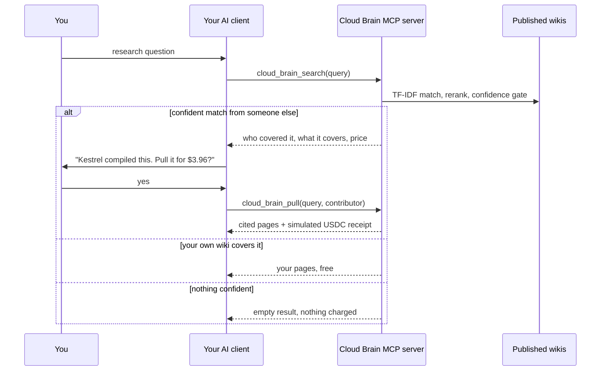
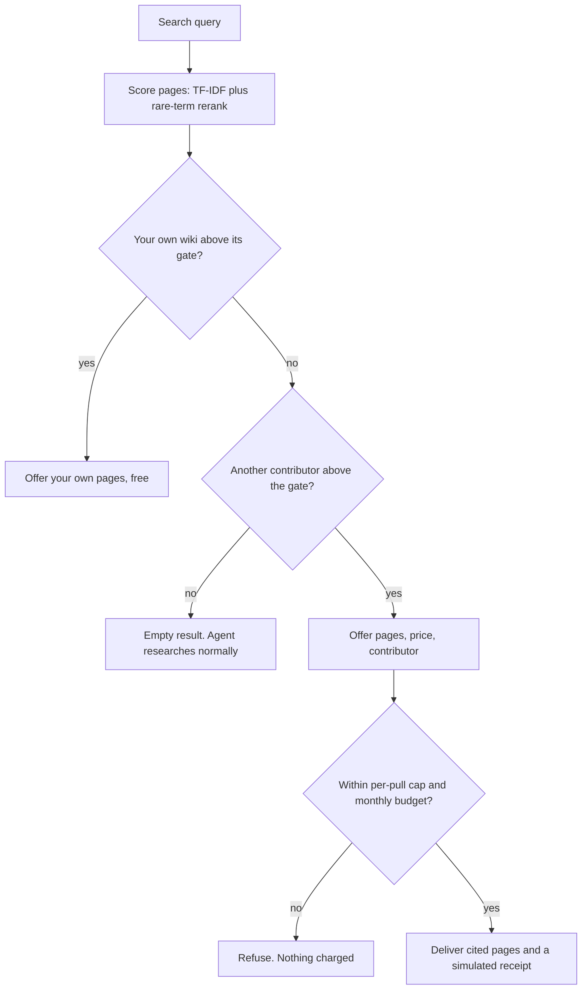

# Cloud Brain

[](https://github.com/ayushcchoudhary-hub/cloud-brain/actions/workflows/test.yml)

An MCP server that lets an AI session reuse research someone else already
compiled. People publish their markdown research wikis. When your agent hits a
topic that someone has covered in depth, it offers to pull that research into
the session for a few dollars. When nothing matches, it stays quiet.

Built over two days in April 2026, a few days after Karpathy's post on
LLM-compiled personal wikis. Shelved soon after. Payments were always
simulated. Prices show in USDC for readability, and nothing touches a chain.


The chat window is a mockup. Every tool call and tool response in it is real
output from this server, taken from [docs/demo-transcript.json](docs/demo-transcript.json).
The cards, step banners and the user and assistant lines are written by hand.
You can reproduce the tool output with `npm run demo`.

| Step | What happens | Why it matters |
|---|---|---|
| 1 | "Compare USDC, PYUSD and USDe for a $5M treasury." Another contributor has compiled 6 pages on it. The agent asks, pulls 3 cited pages and gets a simulated $3.96 receipt | Days of someone else's research for a few dollars, inside the session |
| 2 | "How should an agent decide whether to pay for a tool call?" Your own wiki covers it | Your own notes come first and cost nothing |
| 3 | "What does a seed-stage startup need for SOC 2?" Nobody covered it | The server returns nothing. No weak matches, no charge |
| 4 | A second paid pull would go over the $5 monthly budget (terminal demo only) | Spend limits are enforced in code, not left to the model |

## The problem

Deep research with an LLM is expensive and then thrown away. Converging on one
topic took me days of sessions, millions of tokens and, by my estimate at the
time, $15 to $50 of API cost. The next person who researches the same topic
starts from zero and pays the full cost again.

The output of that work, a compiled wiki page, still has salvage value. The bet:

> An agent will pay about $3 mid-session for research someone already
> compiled, instead of spending $30 and two days re-deriving it.

The pulled research is an input, not a finished answer. Your own session adapts
it to your context.

## Why April 2026

Three things showed up at the same time:

- **Structured supply.** Karpathy-style wikis became a common pattern for
  keeping compiled LLM research as linked markdown pages.
- **Distribution.** MCP put one tool interface inside Claude, ChatGPT, Cursor
  and other clients. A network could live inside the session instead of on a
  website nobody visits.
- **Cheap machine payments.** Stablecoins made a $3 payment between two
  agents cheap enough to be worth doing.

## How it works



The confidence gate is what keeps it low-noise. A weak match is worse than no
match, so the server would rather return nothing:



Contact details such as emails and phone numbers are redacted when a page is
parsed, and the publish preview and every pulled answer are scanned for PII
again. Pages are checked for prompt injection when published (flagged pages
are quarantined) and again when pulled. A content hash confirms a page did not
change after publishing.

The search result tells the agent to ask the user before pulling, and price
caps and the monthly budget are enforced in code. The ask itself is left to
the agent. For a hard two-step flow, the marketplace tools below split it into
a quote and a separate settle call.

### Tools

| Tool | Purpose |
|---|---|
| `cloud_brain_search` | Check published wikis (yours first) during deep research. Returns nothing when no match is confident |
| `cloud_brain_pull` | Pull cited pages from one contributor, within price and budget limits. Returns a simulated receipt |
| `cloud_brain_feedback` | Rate whether a pull helped. Feeds contributor reputation |

The marketplace tools from the original build (`cloud_brain_quote`,
`cloud_brain_settle`, `cloud_brain_history`, `cloud_brain_marketplace_summary`)
are still there, behind `CLOUD_BRAIN_MARKETPLACE=true`.

## Run it yourself

Needs Node.js 22. No API keys, no database. It runs in memory on three
fictional [sample wikis](sample-wikis/README.md), compiled from public sources:

- **Kestrel**: stablecoin issuers compared for a company treasury (someone else's wiki)
- **Otter**: agent payments and x402 (treated as your own wiki)
- **Heron**: UK heat pump retrofit (far away on purpose, so most questions miss it)

```sh
npm install
npm run demo   # the scripted session, driven through a real MCP client
npm test       # 25 tests: parser, PII and injection scans, search, pulls, budgets, MCP tools
```


To use it from Claude Desktop, add this to `claude_desktop_config.json` and
restart:

```json
{
  "mcpServers": {
    "cloud-brain": {
      "command": "node",
      "args": ["/absolute/path/to/cloud-brain/bin/mcp.mjs"]
    }
  }
}
```

To point it at your own markdown, set `WIKI_DIR` to a folder with one subfolder
per contributor and `OWN_HANDLE` to yours. See [.env.example](.env.example).

## What is real and what is simulated

| Part | State |
|---|---|
| Wiki parser: any folder of `.md`, wikilinks, topics, depth score | Real |
| PII scan and prompt-injection scan | Real, regex based |
| Search: TF-IDF with a rare-term rerank and a confidence gate | Real |
| MCP server and the three tools | Real, tested through an in-process MCP client |
| Prices, budgets, per-pull caps, quote expiry | Real logic |
| Payments | **Simulated.** Receipts are `sim_` ids. No wallet, no chain, no funds |
| Contributor reputation | A simple nudge from feedback, not a real reputation system |
| The network | **Three fictional sample wikis.** In April it was my own wiki plus one seeded contributor |
| Supabase and OpenAI backend | Kept from the original build. It typechecks but has not been run since the cleanup |

The demo prices depend on page depth and reputation. They show the mechanics.
They are not market prices.

## Why I shelved it

It was a quick experiment, and the value turned out smaller than the bet:

- **Re-deriving research got cheaper.** Tokens kept getting cheaper, so the
  cost a pull saves kept shrinking. A $3 shortcut is less interesting when
  doing it yourself costs less every month.
- **People want to steer their research.** When I talked to people, they
  wanted to course-correct as they went: change the angle, go deeper on one
  part, drop another. Someone else's finished conclusions are a weaker input
  than I expected.
- **Paying before you can judge quality needs trust.** You cannot see the
  research before you pay for it. That needs a reputation system, which needs
  volume, which needs trust first. The network had none of these yet.

What I would test next: measure lift directly. Capture the buyer's draft before
a pull and after it, and have a judge model score whether the pulled research
changed the work for the better. Price, reputation and refunds would then come
from measured lift instead of thumbs up.

## Project context and authorship

This is a product-led project. I am not a software engineer. I framed the
problem and wrote a stress test of the idea: the assumptions it rests on,
competitors, unit economics and the strongest arguments against it. That
killed the first version, a website where you buy wiki pages from strangers.
I then directed AI coding agents, Codex and Claude Code, to build the second
version in April 2026.

My part was the product decisions: put the network inside the AI client
instead of on a website, stay quiet unless the match is confident, check your
own wiki first, ask before paying, never auto-settle a low-confidence match,
and stop when the evidence did not support going further.

The original build lived in a private repository. In November 2026 I used
Claude Code to clean it up for publication: one package with small modules, an
in-memory backend so it runs with no keys, neutral sample data, tests and this
README. The history starts at that import, so commit dates show the cleanup,
not the April build.

## Where things live

| Folder | What it holds |
|---|---|
| `src/wiki/` | Parsing markdown wikis, PII scanning |
| `src/search/` | Tokenizer, TF-IDF index, rerank, coverage summaries |
| `src/store/` | In-memory store (default) and the optional Supabase store |
| `src/mcp/` | Tool definitions, handlers, the stdio server |
| `src/service.ts` | Search, pull, quotes, simulated payments, feedback |
| `src/pricing.ts`, `src/safety.ts` | Prices, budgets, injection scan, content hash |
| `src/demo.ts` | `npm run demo` |
| `sample-wikis/` | Three fictional contributors |
| `test/` | The test suite |
| `docs/` | Demo transcript, GIFs and the script that renders the chat GIF |

## License

MIT. See [LICENSE](LICENSE).
