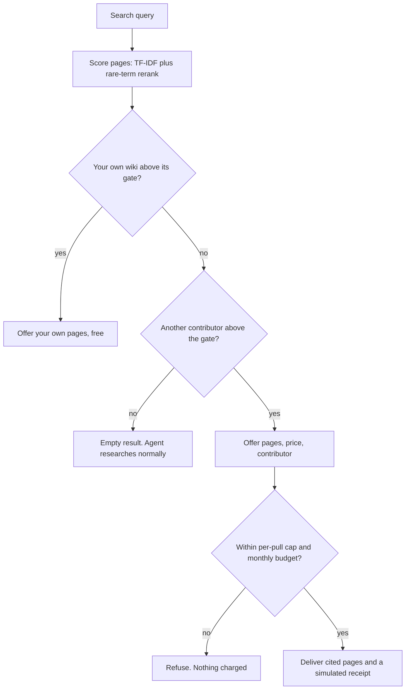

# Cloud Brain

[](https://github.com/ayushcchoudhary-hub/cloud-brain/actions/workflows/test.yml)

An MCP server that lets an AI session reuse research someone else already
compiled. People publish their markdown research wikis. When your agent hits a
topic that someone has covered in depth, it offers to pull that research into
the session for a few dollars. When nothing matches, it stays quiet.

I built it privately over two days in April 2026, five days after Andrej
Karpathy's [post on LLM knowledge bases](https://x.com/karpathy/status/2039805659525644595)
([gist](https://gist.github.com/karpathy/442a6bf555914893e9891c11519de94f)),
and shelved it soon after. I cleaned it up and published it here in November
2026, so the commit dates are November. Prices are in USDC because the plan was
stablecoin micropayments between agents. Payments are simulated: there is no
wallet and nothing touches a chain.


The cards in the first shot are illustrative. The query, the tool responses,
the price and the receipt are real output from this server, trimmed to the
lines that matter. The full responses are in
[docs/demo-transcript.json](docs/demo-transcript.json), and `npm run demo`
prints the same output, receipt ids included. The clip is rebuilt from
[docs/film](docs/film/README.md).

`npm run demo` walks through four steps:

| Step | What happens | Why it matters |
|---|---|---|
| 1 | "How big is the shadow tanker fleet carrying Russian crude, how does it avoid the price cap, and what enforcement has worked?" Another contributor has compiled 6 pages on this. The agent asks, then pulls 3 cited pages for a simulated $3.84 | Someone else's compiled research, inside the session, for a few dollars |
| 2 | "What FDA pathway would an AI triage tool for chest X-rays use, and what can a PCCP let us change after clearance?" Your own wiki covers it | Your own notes come first and cost nothing |
| 3 | "What does a seed-stage startup need for SOC 2?" Nobody covered it | The server returns nothing. No weak matches, no charge |
| 4 | A second paid pull would go over the $5 monthly budget | Spend limits are enforced in code, not left to the model |

## The problem

Deep research with an LLM is expensive and then thrown away. Converging on one
topic took me days of sessions, millions of tokens and, by my estimate at the
time, $15 to $50 of API cost. The next person who researches the same topic
starts from zero and pays the full cost again.

The output of that work, a compiled wiki page, still has salvage value. The bet:

> An agent will pay about $3 mid-session for research someone already
> compiled, instead of spending $30 and two days re-deriving it.

The pulled research is an input, not a finished answer. Your own session adapts
it to your context. The timing looked right in April 2026: Karpathy-style wikis
gave a common shape for compiled research, and MCP put one tool interface
inside Claude, ChatGPT, Cursor and other clients.

## Why I shelved it

It was a quick experiment, and the value turned out smaller than the bet:

- **Re-deriving research got cheaper.** Tokens kept getting cheaper, so the
  cost a pull saves kept shrinking. A $3 shortcut is less interesting when
  doing it yourself costs less every month.
- **People want to steer their research.** When I talked to people, they
  wanted to course-correct as they went: change the angle, go deeper on one
  part, drop another. Someone else's finished conclusions are a weaker input
  than I expected.
- **Paying before you can judge quality needs trust.** You cannot see the
  research before you pay for it. That needs a reputation system, which needs
  volume, which needs trust first. The network had none of these yet.

What I would test next: measure lift directly. Capture the buyer's draft before
a pull and after it, and have a judge model score whether the pulled research
changed the work for the better. Price, reputation and refunds would then come
from measured lift instead of thumbs up.

## Project context and authorship

This is a product-led project. I am not a software engineer. I framed the
problem and wrote a stress test of the idea: the assumptions it rests on,
competitors, unit economics and the strongest arguments against it. That
killed the first version, a website where you buy wiki pages from strangers.
I then directed AI coding agents, Codex and Claude Code, to build the second
version.

My part was the product decisions: put the network inside the AI client
instead of on a website, stay quiet unless the match is confident, check your
own wiki first, ask before paying, never auto-settle a low-confidence match,
and stop when the evidence did not support going further.

The original build lived in a private repository. In November 2026 I used
Claude Code to clean it up for publication: one package with small modules, an
in-memory backend so it runs with no keys, sample data compiled from public
sources, tests and this README.

## How it works

The agent calls `cloud_brain_search` during deep research. The confidence gate
decides what happens next. A weak match is worse than no match, so the server
would rather return nothing:



The search result tells the agent to ask the user before pulling. Price caps
and the monthly budget are enforced in code, but the ask itself is left to the
agent. For a hard two-step flow, the marketplace tools below split it into a
quote and a separate settle call.

Pages get two basic safety checks. A regex screen redacts emails and phone
numbers when a page is parsed and scans every pulled answer for PII. A second
regex screen flags common prompt-injection phrases when a page is published
(flagged pages are quarantined) and again when it is pulled. A content hash
confirms a page did not change after publishing. These are screens, not
guarantees.

| Tool | Purpose |
|---|---|
| `cloud_brain_search` | Check published wikis (yours first) during deep research. Returns nothing when no match is confident |
| `cloud_brain_pull` | Pull cited pages from one contributor, within price and budget limits. Returns a simulated receipt |
| `cloud_brain_feedback` | Rate whether a pull helped. Feeds contributor reputation |

The marketplace tools from the original build (`cloud_brain_quote`,
`cloud_brain_settle`, `cloud_brain_history`, `cloud_brain_marketplace_summary`)
are still there, behind `CLOUD_BRAIN_MARKETPLACE=true`.

## Run it yourself

Needs Node.js 22. No API keys, no database. It runs in memory on three
fictional [sample wikis](sample-wikis/README.md), compiled from public sources:

- **Kestrel**: the shadow tanker fleet carrying Russian crude (someone else's wiki)
- **Otter**: FDA pathways for AI-enabled medical devices (treated as your own wiki)
- **Heron**: UK heat pump retrofit (far away on purpose, so most questions miss it)

```sh
npm install
npm run demo   # the scripted session, driven through a real MCP client
npm test       # parser, PII and injection screens, search, pulls, budgets, MCP tools
```


To use it from Claude Desktop, add this to `claude_desktop_config.json` and
restart:

```json
{
  "mcpServers": {
    "cloud-brain": {
      "command": "node",
      "args": ["/absolute/path/to/cloud-brain/bin/mcp.mjs"]
    }
  }
}
```

To point it at your own markdown, set `WIKI_DIR` to a folder with one subfolder
per contributor and `OWN_HANDLE` to yours. See [.env.example](.env.example).

## What is real and what is simulated

| Part | State |
|---|---|
| Wiki parser: any folder of `.md`, wikilinks, topics, depth score | Real |
| PII and prompt-injection screens | Real, regex based |
| Search: TF-IDF with a rare-term rerank and a confidence gate | Real |
| MCP server and the three tools | Real, tested through an in-process MCP client |
| Prices, budgets, per-pull caps, quote expiry | Real logic |
| Payments | **Simulated.** Receipts are `sim_` ids. No wallet, no chain, no funds |
| Contributor reputation | A simple nudge from feedback, not a real reputation system |
| The network | **Three fictional sample wikis.** In April it was my own wiki plus one seeded contributor |
| Supabase and OpenAI backend | Kept from the original build. It typechecks but has not been run since the cleanup |

The demo prices depend on page depth and reputation. They show the mechanics.
They are not market prices.

## Where things live

| Folder | What it holds |
|---|---|
| `src/wiki/` | Parsing markdown wikis, PII screen |
| `src/search/` | Tokenizer, TF-IDF index, rerank, coverage summaries |
| `src/store/` | In-memory store (default) and the optional Supabase store |
| `src/mcp/` | Tool definitions, handlers, the stdio server |
| `src/service.ts` | Search, pull, quotes, simulated payments, feedback |
| `src/pricing.ts`, `src/safety.ts` | Prices, budgets, injection screen, content hash |
| `src/demo.ts` | `npm run demo` |
| `sample-wikis/` | Three fictional contributors |
| `test/` | The test suite |
| `docs/` | Demo transcript, the clip and terminal GIFs, and the scripts that render them |

## License

MIT. See [LICENSE](LICENSE).
